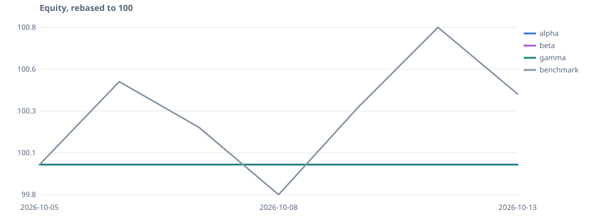

# Portfolio status

Updated 2026-10-13 20:01 CEST. Generated on the N100 from the ledger; decisions are executed by the paper execution system (no broker).

| Manager | Equity | Return | vs iShares Core MSCI World UCITS ETF (Acc) | Last decision | Runs (7 days) |
| --- | ---: | ---: | ---: | --- | --- |
| [alpha](agents/alpha.md) | 100,000.00 | 0.0 % | -0.41 pp | 2026-10-13 14:05 CEST NEUTRAL (conf 0.50, 0 order(s)) | success 1 |
| [beta](agents/beta.md) | 100,000.00 | 0.0 % | -0.41 pp | 2026-10-13 14:05 CEST NEUTRAL (conf 0.20, 0 order(s)) | success 1 |
| [gamma](agents/gamma.md) | 100,000.00 | 0.0 % | -0.41 pp | 2026-10-13 14:05 CEST NEUTRAL (conf 0.50, 0 order(s)) | success 1 |

## Data

- Latest price session: 2026-10-13 (expected: 2026-10-12); quality labels are on each agent page
- Benchmark: iShares Core MSCI World UCITS ETF (Acc) (IE00B4L5Y983)
- Last yahoo-chart collection: complete at 2026-10-13 18:39 CEST

Weekly reviews: [reports/](reports/)
